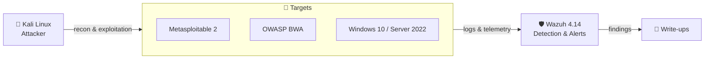

<div align="center">

<br>

# `>_ Muhammad Zaid`

**Computer Science Student &nbsp;·&nbsp; SOC Analyst Intern &nbsp;·&nbsp; Offensive Security Learner**

<sub>Breaking things in labs, so I can learn to detect and defend them in the real world.</sub>

<br>

<a href="https://www.linkedin.com/in/muhammad-zaid2009/"></a>
<a href="https://tryhackme.com/p/muhammadzaid2009"></a>
<a href="https://muhammad-zaid.gitbook.io/muhammad-zaid-ctf-docs/"></a>
<a href="https://medium.com/@muhammadzaid2009"></a>
<a href="mailto:muhammadzaid2009@outlook.com"></a>

<br><br>


</div>

<br>

## 🖥️ `whoami`

```console
zaid@secure-lab:~$ whoami
muhammad-zaid  # computer science student, security-focused

zaid@secure-lab:~$ cat profile.txt
role        : SOC L1 Intern @ DeepAegis
siem        : Wazuh (alert triage, web-server log investigation)
offensive   : web app testing, pentest methodology (authorized labs only)
languages   : Python, Bash, PowerShell, C, C++
learning    : Active Directory, red teaming, bug bounty, Java (planned)
mindset     : evidence first, document everything

zaid@secure-lab:~$ echo $GOAL
Become a well-rounded security professional who understands both attack and defense.
```

<br>

## 🎯 What I Do

<table>
  <tr>
    <td width="50%" valign="top">
      <h3>🛡️ Blue Team · SOC</h3>
      SOC L1 intern at <b>DeepAegis</b>, working with <b>Wazuh</b> as a SIEM. I triage alerts, investigate suspicious HTTP activity in Apache/web-server logs, review detection rules, and report findings with evidence.
    </td>
    <td width="50%" valign="top">
      <h3>🔎 Red Team · Offensive</h3>
      Practising web application testing and penetration-testing methodology in authorized lab environments, from enumeration to exploitation to a clear write-up.
    </td>
  </tr>
  <tr>
    <td width="50%" valign="top">
      <h3>🐍 Automation · Scripting</h3>
      Building practical tools in <b>Python</b> and <b>Bash</b> to automate repetitive security tasks, from log parsing to recon helpers.
    </td>
    <td width="50%" valign="top">
      <h3>🪟 Windows · Active Directory</h3>
      Developing AD foundations through home labs and guided exercises, learning how Windows environments are built and where they break.
    </td>
  </tr>
</table>

<br>

## 💼 Experience

| | |
| :-- | :-- |
| **SOC L1 Intern**<br><sub>DeepAegis</sub> | Monitoring and triaging alerts in Wazuh, investigating web-server events, and producing evidence-based incident notes. |

<br>

## 🧰 Skills & Technologies

<div align="center">

| | |
| :-- | :-- |
| **🔐 Security** |      |
| **💻 Languages** |      |
| **🖧 Systems** |      |
| **🛠️ Workflow** |     |

</div>

<sub>Tools I use or am actively learning. I'm building depth through labs and projects.</sub>

<br>

## 🧪 Home Lab

A VMware-based lab where I practise attacks and, just as importantly, watch what they look like in telemetry.



<br>

## 🚀 Projects & Write-ups

| Project | What's inside | Activity |
| :-- | :-- | :-- |
| 📘 [**CTF & Lab Write-ups**](https://muhammad-zaid.gitbook.io/muhammad-zaid-ctf-docs/) | Methodology, enumeration, findings, and lessons learned. |  |
| 📂 [**Write-Ups**](https://github.com/muhammadzaid2009-sudo/Write-Ups) | Security notes and CTF write-ups, versioned on GitHub. |  |
| 🧰 [**Scripts & Tools**](https://github.com/muhammadzaid2009-sudo/Scripts-and-Tools) | Custom scripts and tools I built for security tasks. |  |
| 🐍 [**Python Projects**](https://github.com/muhammadzaid2009-sudo/Python-Projects) | A collection of Python projects. |  |
| ✍️ [**Medium Articles**](https://medium.com/@muhammadzaid2009) | Articles and reflections on technology and cybersecurity. |  |

<br>

## 🏅 Achievements

- 🥇 Completed the [**Jr Penetration Tester path**](https://tryhackme.com/certificate/THM-BTSJQLU7VA) on TryHackMe
- 🛡️ Hands-on SOC investigation experience with Wazuh and web-server logs
- 🧪 Built and maintain a multi-OS home lab with detection telemetry
- 📚 Publishing write-ups on GitBook, GitHub, and Medium

<br>

## 🗺️ Roadmap

- [x] TryHackMe Jr Penentration Testing Path
- [x] Wazuh home lab + SOC internship
- [ ] Web application security and bug bounty practice
- [ ] Active Directory attack and defense labs
- [ ] Deeper Python, then C++ and Java

<br>

## 🤝 Let's Connect

I'm open to learning opportunities and collaboration on beginner-friendly **cybersecurity, defensive security, and Python automation** projects.

<div align="center">

<a href="mailto:muhammadzaid2009@outlook.com"></a>
<a href="https://www.linkedin.com/in/muhammad-zaid2009/"></a>

<br><br>

<sub>🔐 Security is a practice, not a product.</sub>

</div>
